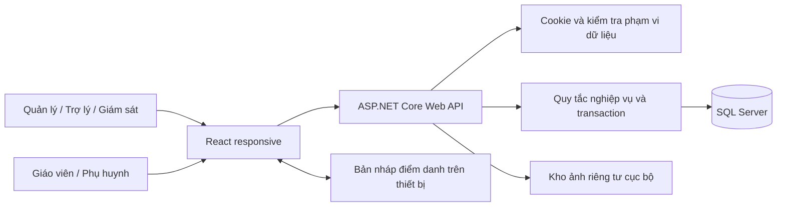

# Kiến trúc

React phục vụ Web quản trị và giao diện mobile cho Giáo viên/Phụ huynh. Frontend chỉ gọi `/api`; không giữ dữ liệu nghiệp vụ thay cho SQL Server. Khi build, Vite đặt file tĩnh vào `backend/wwwroot`, giúp API và UI cùng origin, dùng cookie HttpOnly và không cần CORS.

## Dữ liệu

Mỗi thực thể có khóa Guid; mã học viên là mã hiển thị duy nhất, không sửa được. Tài liệu đầu vào chưa có ERD hay danh sách tên bảng/khóa đã được phê duyệt; tên kỹ thuật trong mã là thiết kế triển khai, không tuyên bố là sao chép một schema gốc chưa được cung cấp.

Các bảng: Branches, Users, Students, Trials, Classes, ClassSchedules, Sessions, Enrollments, Tuitions, Leaves, Attendances, TrialAttendances, Reviews, Progress, Artworks, Notifications, Audit; thêm bảng EF `__EFMigrationsHistory`.

- BranchId giới hạn dữ liệu cơ sở ở tài khoản, lớp, hồ sơ và đơn học thử.
- Một phụ huynh liên kết nhiều học viên và đơn học thử. Học viên không có tài khoản.
- Một yêu cầu nghỉ liên kết đúng ca thường và tối đa một ca bù. Đăng ký/hủy/duyệt cập nhật cùng bản ghi.
- Học phí duy nhất theo học viên/tháng. Lessons là tổng cấp tại lúc ghi nhận, Remaining là số còn lại; không chuyển dư sang tháng sau.
- Sessions lưu ngày, giờ, chương trình và giáo viên của ca. ClassSchedules lưu ngày hiệu lực của từng phiên bản lịch. Ca tương lai thay thế được đánh dấu Cancelled, không xóa dòng lịch cũ.
- Reviews/Progress duy nhất theo học viên/ca. Ảnh gốc và thumbnail có mã ngẫu nhiên, chỉ tải qua endpoint phân quyền.
- Khóa ngoại dùng Restrict; không cascade xóa hồ sơ/lịch sử học tập.

## Tính nhất quán

Các thao tác nhiều bước dùng transaction Serializable. Đăng ký ca học thử/học bù lấy application lock SQL theo ca trước khi đọc sĩ số; lock thuộc transaction và hoạt động giữa nhiều tiến trình API. Sĩ số được kiểm tra lại trong transaction. Xung đột unique/deadlock được báo 409 để tải lại; dữ liệu không được ghi một phần.

Khi chốt điểm danh, ca chỉ được chốt một lần và trừ buổi trong cùng transaction. Một học viên vắng không bị trừ lúc chốt; buổi nghỉ trừ ở nghiệp vụ ghi nghỉ. Bản nháp không xuất hiện trong lịch sử chính thức của phụ huynh.

Background worker hết hạn học bù mỗi 20 giây; danh sách và thao tác liên quan cũng cập nhật hết hạn trước khi xử lý. Chỗ giữ được bỏ khi hết hạn; ca đã phê duyệt không tự bị hết hạn.

## Xác thực

Cookie SameSite Strict, HttpOnly, thời hạn 8 giờ. Mỗi request kiểm tra lại tài khoản bị khóa, vai trò và phiên bản phiên. Cấp lại/đổi mật khẩu làm mất hiệu lực phiên cũ. Mật khẩu hash bằng ASP.NET PasswordHasher; không ghi mật khẩu vào Audit.

Backend có authorize theo vai trò và kiểm tra sở hữu/ca dạy. Ẩn nút ở Frontend không phải cơ chế bảo mật chính. API thay đổi dữ liệu kiểm tra origin; không mở CORS tùy ý. Login, đăng ký học thử và cấp lại mật khẩu có rate limit.

## Phạm vi bản cục bộ

Theo lựa chọn của người dùng, ảnh và thông báo dùng hạ tầng cục bộ để kiểm thử. Chưa cấu hình dịch vụ cloud. Chưa có cam kết SLA vận hành, backup tự động đã cài lịch hoặc chứng nhận tương thích Safari. Không triển khai một bản Frontend tách rời API lên hosting rồi coi đó là hệ thống hoàn chỉnh.
